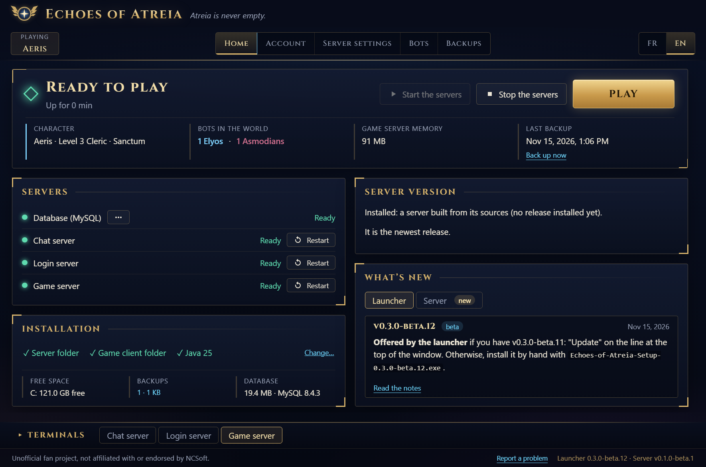
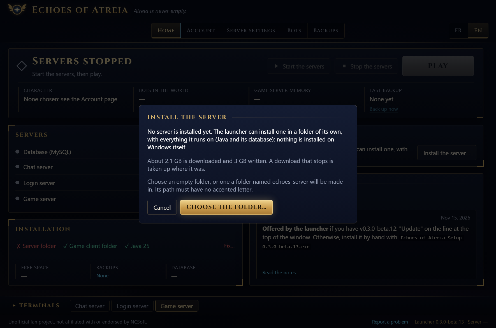
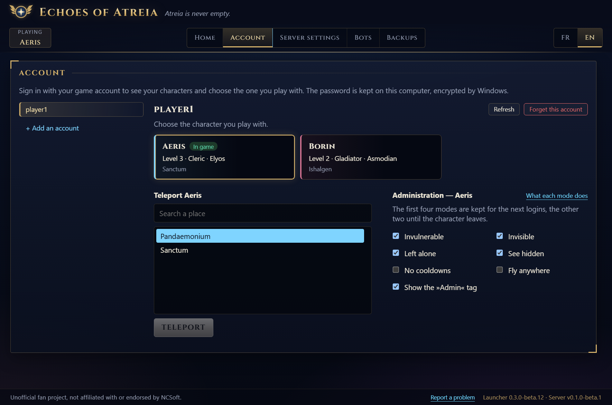
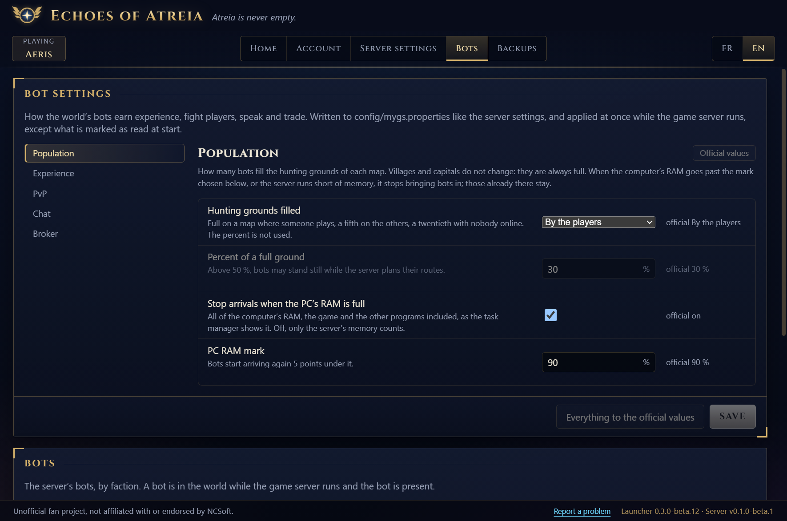
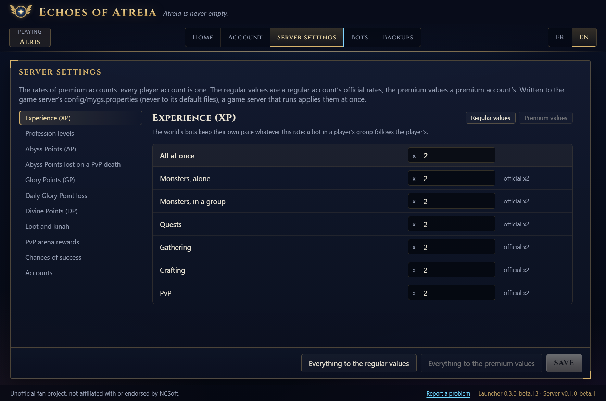
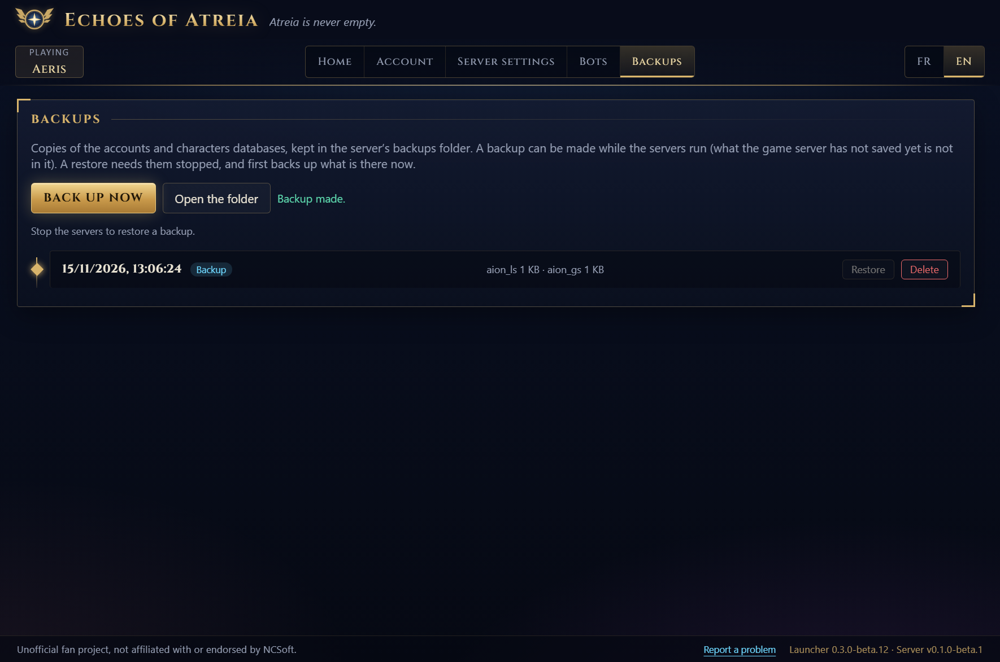

# Echoes of Atreia

All-in-one launcher for a self-hosted Aion 4.8 server populated by AI-driven bots: install the server, play, tune the world and back up your
characters.

> Unofficial fan project, not affiliated with or endorsed by NCSoft. Aion is a trademark of NCSoft Corporation.

The server it drives is [aion-server-playerbots](https://github.com/FayneDre/aion-server-playerbots), a fork of
[beyond-aion/aion-server](https://github.com/beyond-aion/aion-server) with bots that are real player characters.

## A look at it

<p align="center"></p>

| | |
|---|---|
|  |  |
| **Install the server**: on a computer with only the game client, the server, its Java and its database in a folder of their own. | **Account**: sign in, choose the character to play, teleport it, and switch the game master modes of an administrator. |
|  |  |
| **Bots**: how many bots fill the world, how they earn experience, fight players, speak and trade, and who is in the world. | **Server settings**: the experience, drop and other rates, against the official values. |

<p align="center"><br><b>Backups</b>: the accounts and characters databases, backed up and restored in a click.</p>

The pictures are of the launcher in English against the tests' fake install (made-up accounts, characters and bots): `npm run screenshots`
takes them again.

## What it does

**Install and update**
- **The server installed from nothing**: on a computer with only the game client, the launcher downloads and checks the server, its own Java,
  its own MySQL database and the bots' maps (about 2.1 GB), makes the database on a free port, and installs nothing on Windows itself. A
  download that stops is taken up where it was.
- **Server updates**: the server's releases, installed with their database updates and undone in one click; your own settings files are kept.
- **Launcher updates**: a new version is offered on one line at the top of the window, with its notes; nothing is downloaded or installed
  before you say so.
- **Uninstall**: a server the launcher installed is removed from its Installation window, after a last backup of your accounts and characters.

**Play**
- The database, the chat, login and game servers started in order, each waiting for the one before, and stopped cleanly (the game server saves
  its players). A failure keeps its row, with "Why?" and the server's log.
- The game client checked and launched on the server, in the language of its complete language packs.
- The servers' terminals, coloured, in the window.

**The world and its bots**
- **Population**: how full the hunting grounds are (following the players, constant, or with a minimum), and a mark of the PC's RAM past which
  no more bots arrive.
- **Bot settings**: their experience, PvP, chat and its language, and the broker; the list of bots by faction.
- **Server settings**: every rate by family, regular and premium, and the daily Glory Point loss; applied at once to a running server.

**Your account**
- Sign in with a game account, see its characters, choose the one you play, teleport it to a place of the server's list.
- **Administration**, for an administrator character in game: Invulnerable, Invisible, Left alone, See hidden, No cooldowns, Fly anywhere and
  the »Admin« tag.
- **Backups** of the accounts and characters databases, made and restored in one click.

**On the desktop**
- French and English; the icon in the notification area, closing to the background, starting with Windows; a problem report; "What's new"
  for the launcher and the server.

What is done and what comes next: [docs/roadmap.md](docs/roadmap.md). How it runs the servers: [docs/how-it-works.md](docs/how-it-works.md).

## Download

Windows builds are on the [Releases](https://github.com/FayneDre/echoes-of-atreia-launcher/releases) page: an installer, or a portable
exe that runs without installing. They are not signed, so Windows SmartScreen warns the first time: *More info*, then *Run anyway*.

You need Windows and the Aion 4.8 client; the launcher installs the server and what it runs on. The client is not part of this project: see
the server's README for where to find it and the file it needs.

A server installed some other way also works: the launcher finds it through `AION_SERVER_HOME` or the folder chosen in its Installation
window, and then uses a JDK 25 and the MySQL it finds (a Windows service, or one started with your own `my.ini`).

## Development

Requires Node.js 24 or later.

```sh
npm install
npm run dev        # the launcher with hot reload
npm run typecheck  # TypeScript, no build
npm run test:unit  # Vitest, the logic that needs no window
npm run test:e2e   # builds, then drives the real window with Playwright, against fake servers
npm test           # all three
npm run dist       # the Windows installer and portable exe, in dist/
npm run screenshots  # the README's pictures, into docs/images/
```

Layout:

- `src/main/` — the Electron main process: the servers and the client, the database and backups, the server's install and updates, the
  launcher's own updates.
- `src/preload/` — the only bridge between the interface and the system (`window.launcher`).
- `src/renderer/` — the interface, in React; texts live in `src/renderer/src/i18n/` (English is the reference).
- `tests/e2e/` — Playwright tests against the built application, each on a throwaway profile and a fake install.

## Licence

[GNU General Public License v3.0](LICENSE) or later, like the server it drives.
