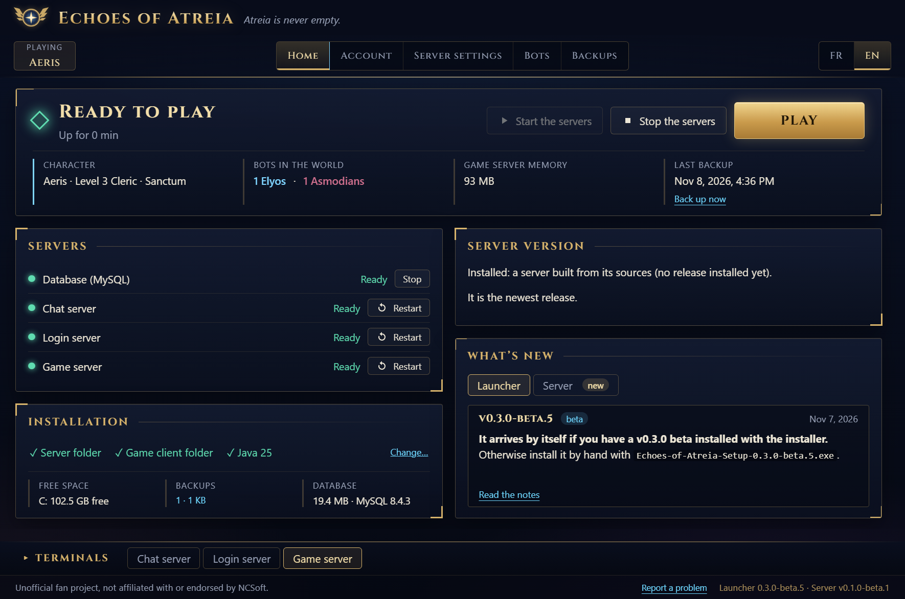
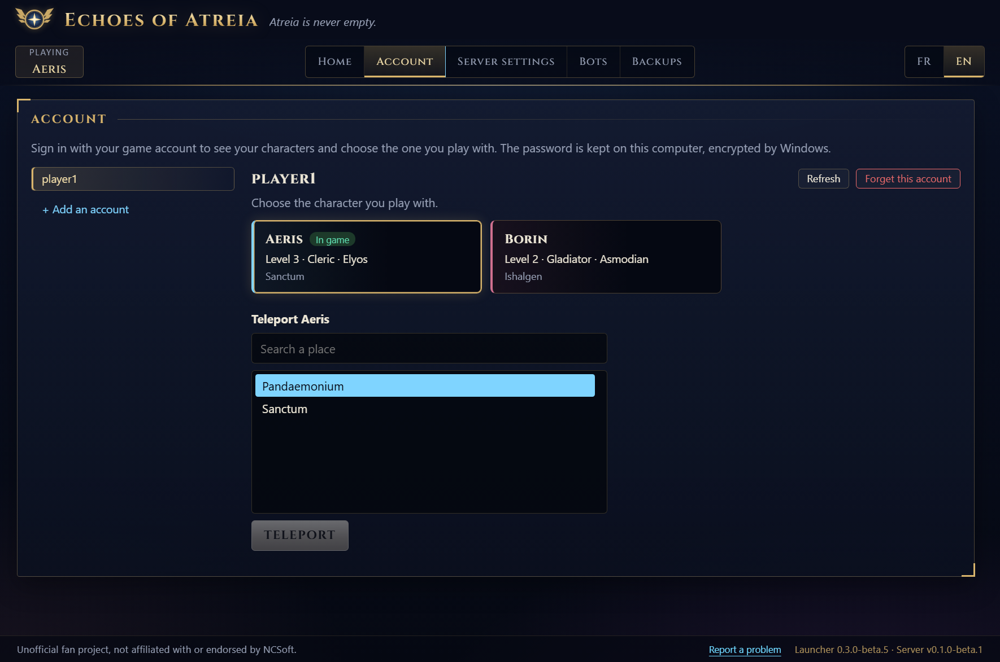
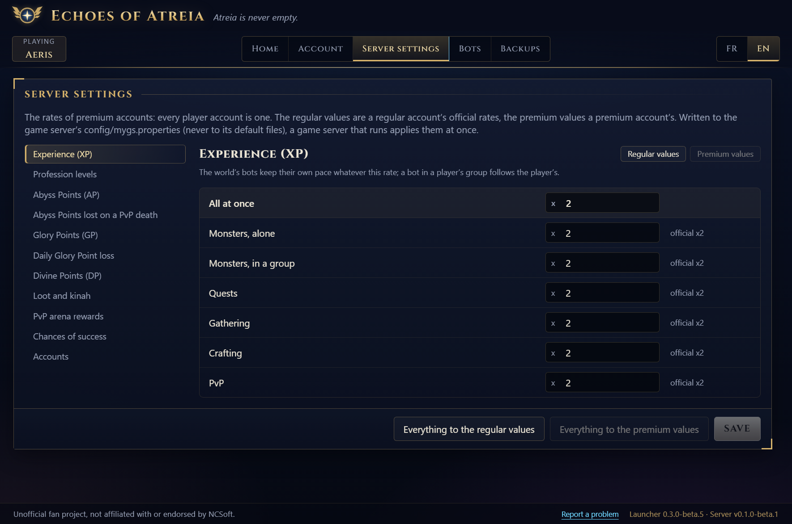
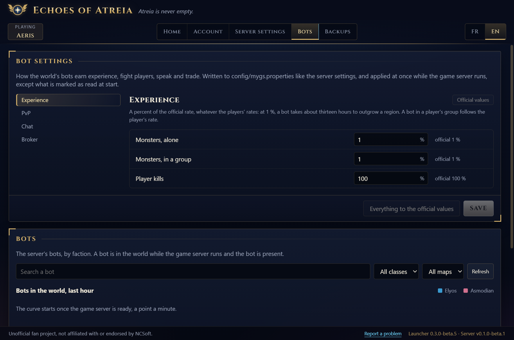
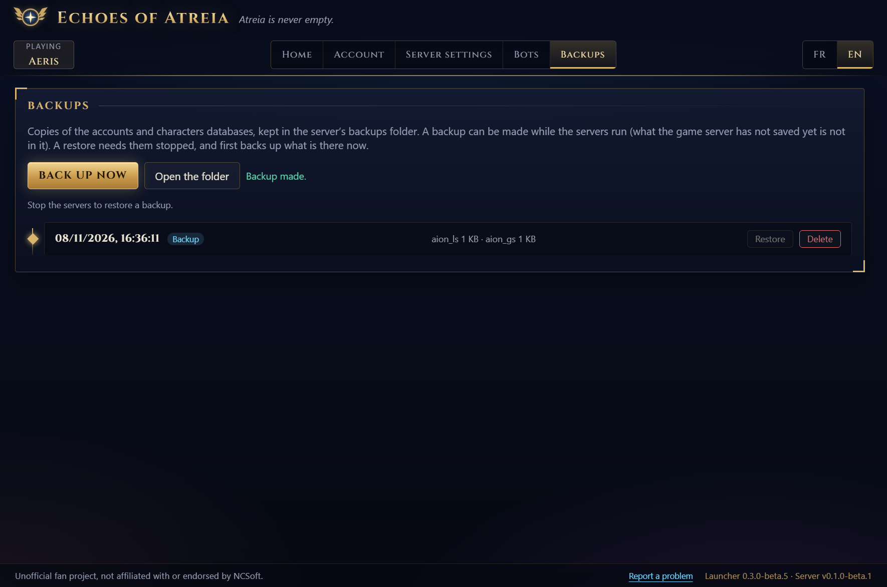

# Echoes of Atreia

All-in-one launcher for a self-hosted Aion 4.8 server populated by AI-driven bots: install, play and back up your characters.

> Unofficial fan project, not affiliated with or endorsed by NCSoft. Aion is a trademark of NCSoft Corporation.

The server it drives is [aion-server-playerbots](https://github.com/FayneDre/aion-server-playerbots), a fork of
[beyond-aion/aion-server](https://github.com/beyond-aion/aion-server) with bots that are real player characters.

## Status

Early development. The launcher finds the server, the client, Java and MySQL; starts the servers in order and stops them without losing
data; shows their terminals; and launches the game. See [docs/roadmap.md](docs/roadmap.md) for what is done and what comes next and
[docs/how-it-works.md](docs/how-it-works.md) for how it runs the servers.

## A look at it

<p align="center"></p>

| | |
|---|---|
|  |  |
| **Account**: sign in with a game account, choose the character to play, teleport it. | **Server settings**: the experience, drop and other rates, against the official values. |
|  |  |
| **Bots**: how the world's bots earn experience, fight players, speak and trade, and who is in the world. | **Backups**: the accounts and characters databases, backed up and restored in a click. |

The pictures are of the launcher in English against the tests' fake install (made-up accounts, characters and bots): `npm run screenshots`
takes them again.

## Download

Windows builds are on the [Releases](https://github.com/FayneDre/echoes-of-atreia-launcher/releases) page: an installer, or a portable
exe that runs without installing. They are not signed, so Windows SmartScreen warns the first time: *More info*, then *Run anyway*.

The launcher drives a server and a client already installed: Java 25 or later, MySQL as a Windows service, the
[server](https://github.com/FayneDre/aion-server-playerbots) and the Aion 4.8 client. It finds the server through `AION_SERVER_HOME` or
the folder chosen in its Installation panel, and the client in a folder next to it, or the one chosen.

## Development

Requires Node.js 24 or later.

```sh
npm install
npm run dev        # the launcher with hot reload
npm run typecheck  # TypeScript, no build
npm run test:unit  # Vitest, the logic that needs no window
npm run test:e2e   # builds, then drives the real window with Playwright, against fake servers
npm test           # all three
npm run dist       # the Windows installer and portable exe, in dist/
npm run screenshots  # the README's pictures, into docs/images/
```

The launcher finds the server through the `AION_SERVER_HOME` environment variable, or the folder chosen in its Installation panel.

Layout:

- `src/main/` — the Electron main process: windows, and later processes, files and the database.
- `src/preload/` — the only bridge between the interface and the system (`window.launcher`).
- `src/renderer/` — the interface, in React; texts live in `src/renderer/src/i18n/` (English is the reference).
- `tests/e2e/` — Playwright tests against the built application, each on a throwaway profile.

## Licence

[GNU General Public License v3.0](LICENSE) or later, like the server it drives.
